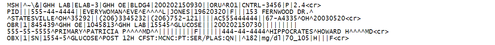

## Software Discovery

Aboard Meetup #61 took place on Tuesday [Oct 27, 2026 19:00
CET](https://www.meetup.com/leipzig-golang/events/312537729) at [Klaustor
Coworking](https://klaustor-coworking.de/) in Halle (Saale).

We had a [short
presentation](https://github.com/miku/silt/tree/main/notes/2026-10-27-leipzig-gophers-61)
on software discovery and an example port of a [rust
project](https://github.com/r14dd/patent) to Go:
[silt](https://github.com/miku/silt).

Software discovery shares a border with
generative AI. Instead of searching for code, you let an LLM write it for you.
Alternative forms are [wishful thinking](https://pypi.org/project/wishful/), or
[ghost functions](https://github.com/bmritz/ai-ghostfunctions).

This phenomenon can be observed in the smaller scale, when people report how
they write helper tools, bash scripts, small automations. The description of
what they would search for becomes the spec of what to build. While some
examples of long-horizon tasks exist, the 80% in 2026 case seems to be small
projects.

## Misc

* [crossplane](https://www.crossplane.io/), a platform engineering framework
* [MUMPS](https://en.wikipedia.org/wiki/MUMPS) is still alive
* [HL-7](https://polavis.de/blog/hl7-format-datenaustausch-in-krankenhaeusern/), a widely used, yet wierd format (not always implemented to spec)

* [To Gen or Not To Gen: The Ethical Use of Generative AI](https://blog.johanneslink.net/2025/11/04/to-gen-or-not-to-gen/)

Even with an LLM you still need to think when designing software:

> Vibe coding helps me move faster.
> Hand-written code helps me think deeper.
> I use both, but I will always enjoy the craft of writing code myself. -- found on [github.com/RowanCole](https://github.com/RowanCole)

## Thanks!

----

[Join our meetup](https://www.meetup.com/de-DE/leipzig-golang/) to get notified of upcoming events.
