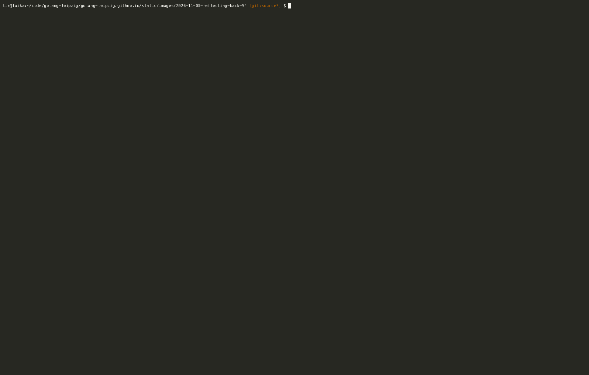

## What a difference a year makes

We just held meetup [#61](https://golangleipzig.space/posts/meetup-61-wrapup/)
on 2026-10-27 in Halle (Saale). About a year ago, we had a drinkup
[#54](https://golangleipzig.space/posts/meetup-54-wrapup/) on 2025-09-30. The
wrap-up blog post for #54 demos
[qwen3-coder:30b](https://ollama.com/library/qwen3-coder) on ollama, running on
a [RTX 4000 SFF "Ada"
GPU](https://www.nvidia.com/content/dam/en-zz/Solutions/rtx-4000-sff/proviz-rtx-4000-sff-ada-datasheet-2616456-web.pdf)
with 20GB VRAM.

If you squint, you can see a tiny bit of agentic coding happening. Claude code
was released in seven month earlier on 2025-02-24
[RT](https://github.com/jqueryscript/anthropic-claude-timeline#quick-release-table),
and accelerated the move to agentic coding. Harnesses were built, models improved.

Today, I can run the [pi](https://pi.dev) or
[zot](https://github.com/patriceckhart/zot) agent harness with
[halogen](https://peonist.ai/halogen/)
([LICENSE](https://github.com/peonist-ai/halogen-server/blob/main/LICENSE.md))
running
[Qwen3.8-Flash-Next](https://qwen.ai/blog?id=qwen3.8-flash-next#performance) on
a [AMD Ryzen AI Max
395+](https://www.amd.com/en/products/processors/laptop/ryzen/ai-300-series/amd-ryzen-ai-max-plus-395.html)
in a  [Framework Desktop](https://frame.work/de/en/desktop) with 128GB [LPDDR5x](https://ibis.org/summits/oct24b//PDFs/04-ZhangH.pdf)-8000:

| Category | Benchmark | Qwen3.8-Flash-Next | Qwen3.8-27B | Qwen3.7-Plus | DeepSeek-V4-Flash-0731 | Claude-Opus-4.6 (Max) |
| --- | --- | --- | --- | --- | --- | --- |
| Model | Params | 125B | 27B | 397B | 284B | -- |
| Model | Activated params | 6B | 27B | 17B | 13B | -- |
| Model | N-gram embedding params | 51B | -- | -- | -- | -- |
| Coding | Agentic coding — DeepSWE 1.1 | **58.7** | 42.2 | 16.5 | 54.4 | -- |
| Coding | Agentic coding — SWE-bench Pro | **62.5** | 61.7 | 55.8 | 56.0 | 53.4 |
| Coding | Multilingual software engineering — SWE-bench Multilingual | **81.0** | 73.8 | 75.8 | -- | 77.5 |
| Coding | Repo-level code generation — NL2Repo-Bench | 48.1 | 42.3 | 41.1 | **54.2** | 47.6 |
| Agent | Long-horizon office work — CoWorkBench | **73.9** | 70.7 | 65.1 | 45.1 | 68.2 |
| Agent | Professional job tasks — JobBench | **55.7** | 33.4 | 27.6 | 41.3 | 36.6 |
| Agent | Frontier agentic tasks — Agents' Last Exam (Pass@1) | 24.3 | 20.4 | 13.2 | **25.2** | -- |
| Agent | Frontier agentic tasks — Agents' Last Exam (Score) | **51.2** | 42.9 | 33.6 | -- | -- |
| Agent | Real-world tool use — Toolathlon Verified (Pass@1) | **73.5** | 67.1 | 50.6 | 70.3 | -- |
| General | Instruction following — IFBench | **81.3** | 79.5 | 79.1 | 79.2 | 62.5 |
| General | Scientific reasoning — GPQA Diamond | **91.7** | 89.2 | 90.3 | 90.8 | 91.3 |
| General | Multidisciplinary reasoning — HLE | 35.9 | 30.8 | 34.7 | 33.8 | **40.0** |
| General | Competitive coding — LiveCodeBench v6 | **91.9** | 90.3 | 89.6 | 90.6 | 88.8 |

The agent take a prompt and in about ten minutes in a multi-turn conversation
builds a 1000+ SLOC inverted index project. The GIF show its work in real-time.
Energy consumption of the FWD under load [stays below](/images/IMG_6748-TEXT-REDUCED-GRAY.mp4) 200W.

